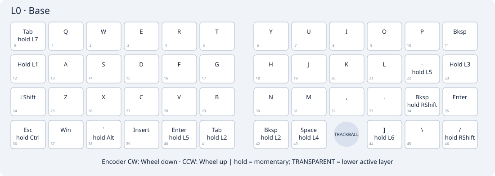
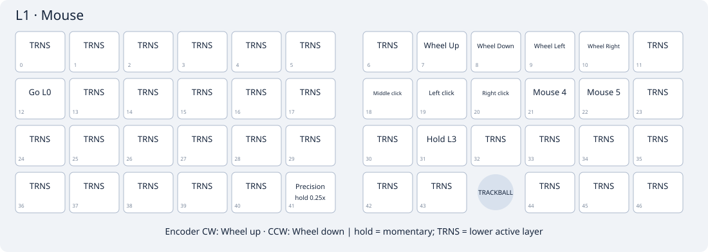
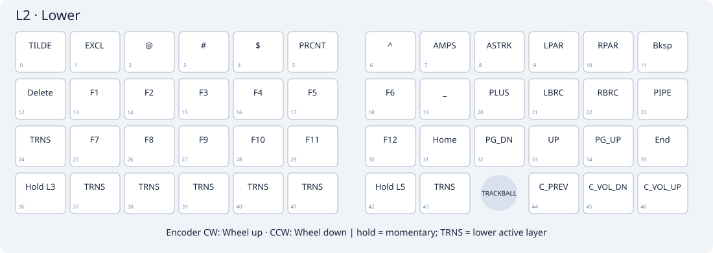
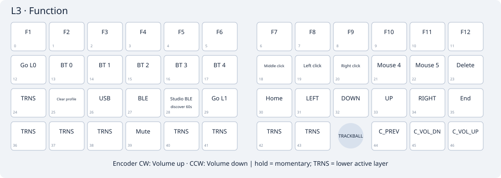
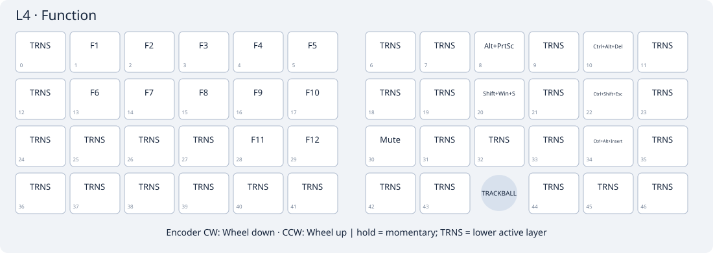
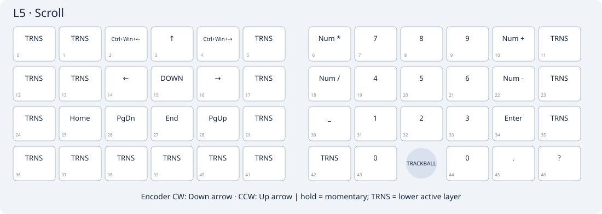
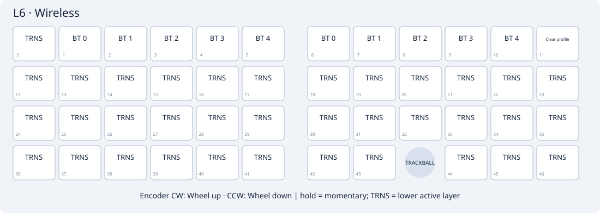
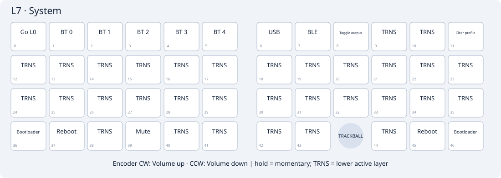

# GridRoll

**English** · [简体中文](README.zh-CN.md) · [日本語](README.ja.md) · [Deutsch](README.de.md)

ZMK firmware for the PandaKB GridRoll split keyboard: 47 keys, a left encoder, a right PAW3222 trackball, USB/Bluetooth, ZMK Studio and DYA Studio.

The **right half is the central** and connects to your computer; the left half connects wirelessly to it. The keyboard, Bluetooth and USB product name is **GridRoll**.

This repository contains firmware, build tools and user documentation. It does not distribute PCB projects, schematics, routing, netlists or internal circuit documents. Firmware-required GPIO definitions remain in the board source.

## Download and flash

1. Open [Build GridRoll firmware](https://github.com/PandaKBLab/GridRoll-zmk-config/actions/workflows/build.yml) and select a successful run.
2. Download the single **GridRoll-firmware** ZIP. It contains exactly three files: **GridRoll-left.uf2**, **GridRoll-right.uf2** and **GridRoll-settings-reset.uf2**.
3. Enter each half's bootloader and copy GridRoll-left.uf2 to the left, GridRoll-right.uf2 to the right. A settings-reset image is not normal keyboard firmware.
4. Controllers without the GridRoll bootloader first need the [first-flash procedure](docs/first-flash.md). Bootloader packages are built separately and are not included in this download.

Artifacts are retained for 30 days. A successful build is software validation, not a hardware test.

## Bluetooth and Studio

Pair your computer with **GridRoll on the right half**. If it is invisible, select an unused Bluetooth profile or clear the selected profile and forget the old pairing on your computer. Normal updates preserve saved bonds.

With the stock Planck-style keymap, hold **Lower + Raise** to enter System: top-row Q selects profile 0, Backspace clears it, Y selects USB and U selects BLE. A new computer USB connection automatically selects USB, even with a saved BLE preference. Charge-only connections do not force USB; unplugging falls back to a connected BLE host. You can manually choose BLE until the next USB connection. Saved layouts may differ.

For [ZMK Studio](https://zmk.studio/) or [DYA Studio](https://studio.dya.cormoran.works/), connect the **right half by USB**, select USB output and choose its serial port. **Studio editing is unlocked by default: no unlock key is required, and idle or disconnect does not relock it.** Close other pages using the same serial port and save your changes. Updates preserve Studio/DYA settings. If you previously compensated the trackball rotation in DYA, remove that extra compensation: mounting correction runs before both pointer and scroll processing.

Both interfaces support keymap editing; DYA also exposes mouse/scroll settings and **per-layer encoder clockwise/counter-clockwise bindings** through `cormoran_rsr`. Base rotation defaults to mouse-wheel scrolling: clockwise up, counter-clockwise down. CI checks all three pinned DYA extension protocols and the compiled unlocked configuration. Sensor imaging and other unimplemented hardware features are not included.

## Eight default layers

The default is a conventional **Planck-style QWERTY / Lower / Raise** layout adapted to GridRoll's 47 keys, with Mouse, Navigation, Scroll, Wireless and System for eight enabled layers. Tab/Esc/Shift/punctuation/Enter are ordinary keys; Lower + Raise opens System. Previous LiNEA40 typing combos are removed. See [all exact bindings, layer access and encoder defaults](docs/keymap.md). Source-generated diagrams are checked by CI.

**Normal updates preserve Studio-saved layouts.** To adopt these defaults, export your old layout and use Studio's restore-defaults operation; do not flash settings-reset just to change keymaps. Symbols use the usual US-style keycodes; actual characters depend on the computer's keyboard layout.

### L0 Base

### L1 Mouse

### L2 Lower

### L3 Navigation

### L4 Raise

### L5 Scroll

### L6 Wireless

### L7 System

## Automatic Mouse layer and wheel

- First nonzero ball movement activates Mouse immediately when no key was pressed in the preceding **200 ms**; this is a typing guard, not a movement-duration requirement.
- Mouse exits **1200 ms** after the last ball movement, discrete wheel step or mouse/modifier release. A held mouse button/modifier protects dragging, including multiple buttons. Ordinary transparent typing keys exit immediately; Esc returns to Base.
- **J = left click, K = right click, H = middle click, L = Back, semicolon = Forward. U/I = wheel up/down; O/P = horizontal left/right.** Hold M for trackball scrolling. Hold right Space for a manual Mouse layer; tap still sends Space.
- Wheel layers use **one discrete wheel step per sensor trigger**, clockwise up and counter-clockwise down. Volume layers keep their direction. The previous 20 ms / 10 steps-per-second emulation could round down to no wheel movement.
- **Saved DYA settings are separate from the saved keymap.** Keep the mouse processor's Temp-layer enabled with layer 1 / activation guard 200 ms / deactivation 1200 ms. If old encoder values remain, set CW to **wheel up**, CCW to **wheel down** on wheel layers L0/L1/L2/L3/L5/L6 and save; leave volume layers L4/L7 unchanged. Restoring only the Studio keymap does not clear old processor or encoder settings; no settings-reset flash is needed.

In **L1 Mouse**, hold **left 46 (row 4, column 6: bottom-right on the left half, Base Space position)** for one quarter of your normal DYA mouse speed; release restores normal speed. Base Space/Ctrl and pointer direction stay unchanged. With a Studio-saved layout, assign **Precision 0.25x (hold)** to L1 left 46, restore left 41 to transparent, and save; no full-layout restore or settings-reset is needed.

## LEDs and battery

| State | Red LED |
|---|---|
| Waiting for the selected computer Bluetooth connection | Right: 100 ms every 2 s, up to 30 s |
| Connected | Right: on for 2 s, then off |
| Local battery estimate ≤15% | Each half: 100 ms every 30 s; clears at ≥20% |
| Normal USB output, idle or sleep | No Bluetooth waiting flashes; red off in idle/sleep |

The left red LED reports only its own low battery. USB power suppresses low-battery flashes. Waiting timeout does not stop Bluetooth advertising. Wake/profile changes or disconnects can open a new waiting window. A connection confirmation takes priority briefly, then returns to any low-battery warning.

Blue remains hardware-controlled: normal first charging cycle on, normal cycle end off. It is not a unique full-charge flag; software estimated 100% does not create a full-charge lamp. See [LED rules, battery sampling and limitations](docs/led-status.md).

The native battery sampler runs once per 60 s while active and stops in idle; wake requests a fresh result. LEDs add no second ADC poller or artificial activity. Both halves need this update; flash left and right without using settings-reset. Existing Studio/DYA layouts, parameters and bonds are preserved.

## Power and wake

- **30 seconds** without input: idle, with Bluetooth available.
- **15 minutes** without input on battery: deep sleep. Press a key on each sleeping half to wake it; allow time for Bluetooth reconnection. Trackball or encoder motion is not a promised deep-sleep wake source.
- USB-powered halves stay awake for USB/Studio use. Save Studio changes before battery sleep; unsaved RAM changes are lost.
- The trackball uses motion interrupts and its existing sensor sleep configuration. Current draw and wake reliability still require physical testing.
- BLE trackball motion is combined into reports at least **8 ms** apart, retaining total displacement; USB output remains immediate. The right half requests a **7.5 ms** host connection interval with zero peripheral latency. The host decides the actual interval, and connected-idle battery consumption may increase. This change still needs a physical smoothness and power test.

See [maintenance](docs/maintenance.md), [firmware compatibility](docs/hardware.md) and [validation](docs/validation.md). Dependencies are pinned in config/west.yml. Original code is MIT; see [third-party notices](THIRD_PARTY_NOTICES.md) for dependency licenses.
