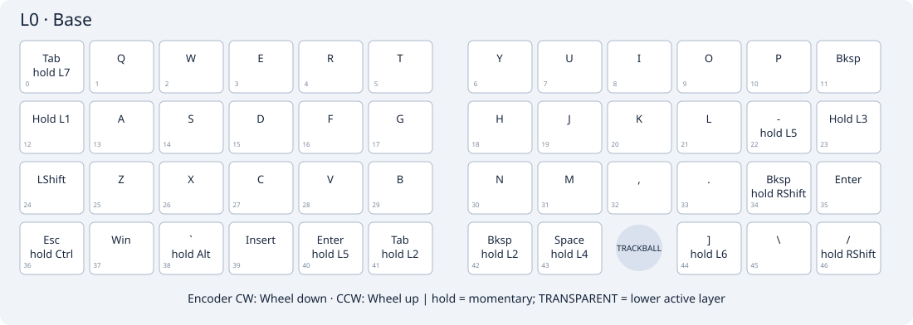
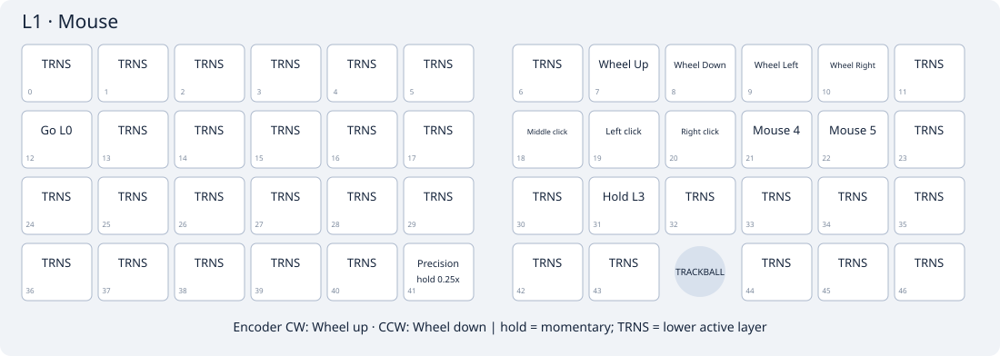
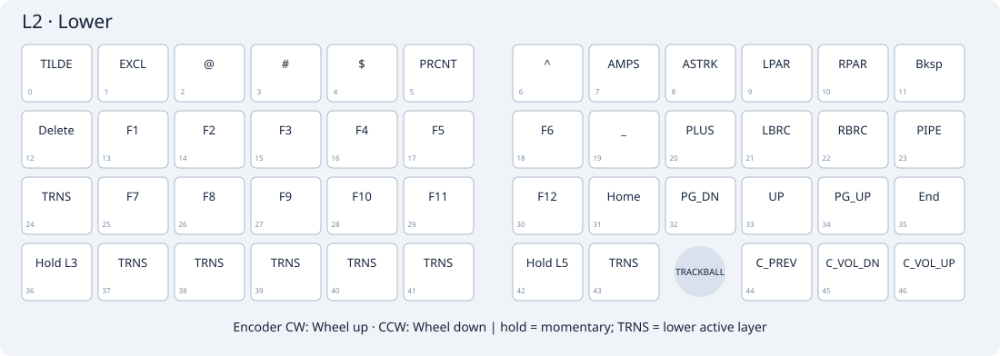
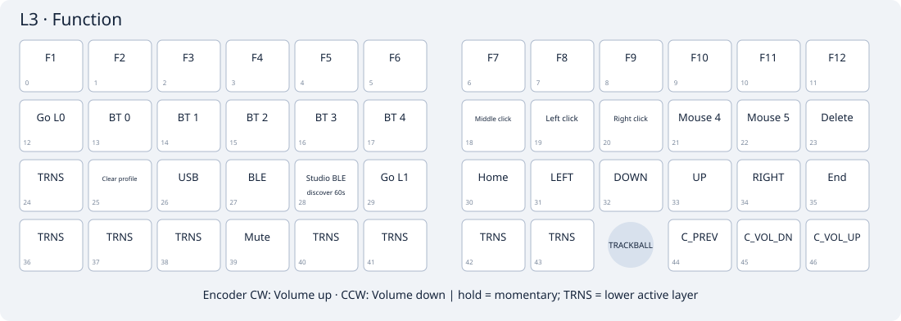
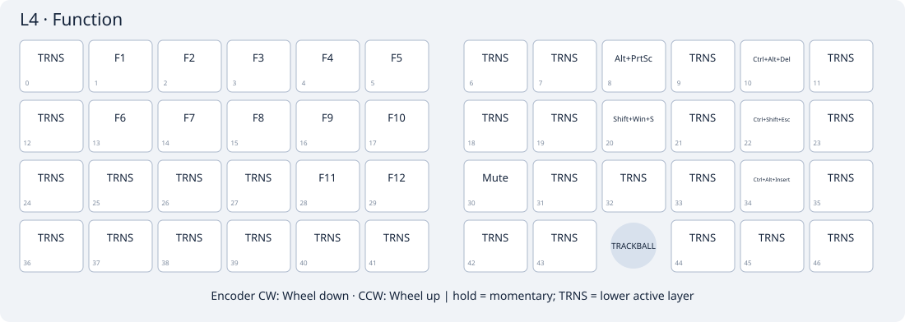
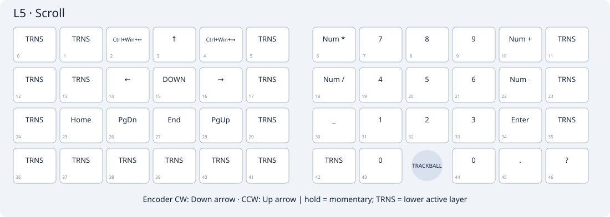
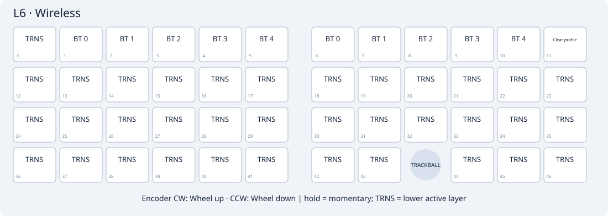
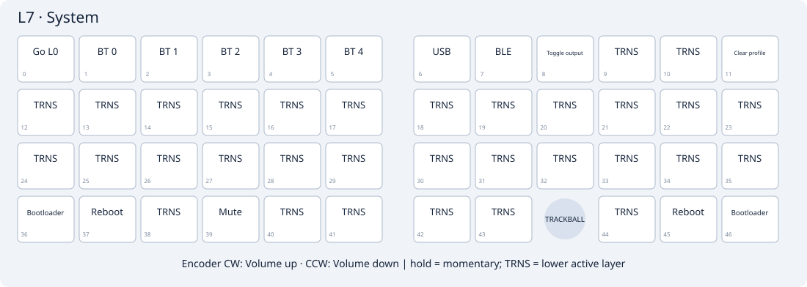

# Eight-layer default keymap / 八层默认键位

These are firmware source defaults, not a readback of a Studio-saved layout. Normal updates preserve saved keymaps. Export your layout before using Studio's restore-defaults operation if you want these defaults; a settings-reset flash is unnecessary and also clears pairing.

这是源码默认键位，普通更新不会覆盖 Studio 已保存的布局。需要采用本页八层时，先导出旧布局，再使用 Studio 恢复默认；无需刷 reset 清除配对。

The conventional Planck QWERTY/Lower/Raise arrangement is adapted to GridRoll's existing 47 positions. No QMK implementation code is imported. Tab, Esc, Shift, punctuation and Enter are ordinary keys. Bottom row: Ctrl, Alt, GUI, encoder middle-click, Lower, Space, Space/Mouse, Raise, trackball opening, Left, Down, Right. Up is available on the navigation layers. Lower + Raise opens System. Previous LiNEA40 combos and Japanese-specific symbols are removed.

Tap-hold keys: right Space taps Space and holds Mouse. `&trans` resolves to a lower active layer. Every layer is enabled and editable in both Studios. The trackball scrolls only in L5. Encoder press is position 39 (bottom-left half, column 3), default middle click. Rotation in Base uses discrete wheel events, one step per sensor trigger; it does not use a short timed mouse-scroll hold.

Auto Mouse defaults: the first nonzero ball movement activates L1 immediately if no key was pressed during the last 200 ms. This 200 ms is a typing guard, not a required movement duration. The owned automatic layer exits 1200 ms after the last movement, wheel step or mouse/modifier release. Holding one or several mouse buttons/modifiers prevents timeout during dragging. A normal transparent typing key exits immediately; Esc also returns to Base. A manually held Mouse layer is not timed out by the automatic controller. There is no periodic idle polling.

默认自动鼠标层：有效拨球立即进入 L1；最近 200ms 内按过键时暂不触发，避免打字误碰。停止拨球、滚轮及鼠标操作 1200ms 后退出；拖拽按住不退出。普通打字键立即退出，Esc 回基础层。J=左键、K=右键、H=中键、L=后退、分号=前进；U/I=滚轮上/下，O/P=横向左/右；按住 M 把轨迹球转为滚动。

L1 Mouse left 41 means left row 4 / column 1 (one-based), the bottom-left Ctrl position, global position 36 / RC(3,0). Hold it for one quarter of the mouse processor's normal DYA speed; release restores normal speed. Base Ctrl is unchanged. Only mouse scaling changes: direction, scrolling, saved settings and sleep policy remain intact. The key adds no timer or flash writes; holding it protects the automatic Mouse layer from timeout.

L1 左手 41（第 4 行第 1 列，最下排最左、基础层 Ctrl 位置）：按住为正常速度的 1/4，松开恢复；基础层仍是 Ctrl。已有 Studio 布局不会被刷机覆盖：在 L1 的这个位置选择 `Precision 0.25x (hold)` 并保存即可，无需恢复整套布局或刷 reset。

Saved DYA values override firmware defaults independently of the saved keymap. For this update, set mouse Temp-layer enabled / layer 1 / activation guard 200 / deactivation 1200, and set Base encoder CW to wheel down and CCW to wheel up if older bindings remain. Save each change. Restoring only the Studio keymap does not reset DYA processor or encoder settings. Keep your speed/rotation settings and Bluetooth pairing.

| Layer | Purpose | Access from Base | Encoder CW / CCW |
|---|---|---|---|
| L0 Base | Planck-style QWERTY / 基础输入 | Power-on default | Wheel down / Wheel up |
| L1 Mouse | Automatic mouse buttons / 自动鼠标层 | Move ball; or hold right Space | Wheel down / Wheel up |
| L2 Lower | Symbols and F keys / 符号与功能键 | Hold Lower (left of left Space) | Wheel down / Wheel up |
| L3 Nav | Navigation / 导航 | Lower + bottom-left Ctrl position | Wheel down / Wheel up |
| L4 Raise | Numbers and F keys / 数字与功能键 | Hold Raise (right of right Space) | Volume up / Volume down |
| L5 Scroll | Trackball scrolling / 轨迹球滚动 | Mouse + M; or Lower + right Space | Wheel down / Wheel up |
| L6 Wireless | Bluetooth profiles / 蓝牙槽位 | Raise + left Shift position | Wheel down / Wheel up |
| L7 System | Output and recovery / 输出与恢复 | Hold Lower + Raise | Volume up / Volume down |

Right USB enumerated by a computer selects USB automatically. A charge-only cable does not force USB. You can manually choose BLE while plugged in: hold Lower + Raise (L7), press top-row U; Y selects USB and I toggles output. A new USB connection prefers USB again. Unplugging falls back to BLE when a host is connected.

## L0 Base

Exact source bindings, viewed from the typing side; `—` is the trackball opening.

| Row | Left 0 | Left 1 | Left 2 | Left 3 | Left 4 | Left 5 | Right 0 | Right 1 | Right 2 | Right 3 | Right 4 | Right 5 |
|---|---|---|---|---|---|---|---|---|---|---|---|---|
| 0 | `&kp TAB` | `&kp Q` | `&kp W` | `&kp E` | `&kp R` | `&kp T` | `&kp Y` | `&kp U` | `&kp I` | `&kp O` | `&kp P` | `&kp BSPC` |
| 1 | `&kp ESC` | `&kp A` | `&kp S` | `&kp D` | `&kp F` | `&kp G` | `&kp H` | `&kp J` | `&kp K` | `&kp L` | `&kp SEMI` | `&kp SQT` |
| 2 | `&kp LSHFT` | `&kp Z` | `&kp X` | `&kp C` | `&kp V` | `&kp B` | `&kp N` | `&kp M` | `&kp COMMA` | `&kp DOT` | `&kp FSLH` | `&kp RET` |
| 3 | `&kp LCTRL` | `&kp LALT` | `&kp LGUI` | `&mkp MCLK` | `&mo LOWER` | `&kp SPACE` | `&lt MOUSE SPACE` | `&mo RAISE` | — | `&kp LEFT` | `&kp DOWN` | `&kp RIGHT` |

## L1 Mouse

Exact source bindings, viewed from the typing side; `—` is the trackball opening.

| Row | Left 0 | Left 1 | Left 2 | Left 3 | Left 4 | Left 5 | Right 0 | Right 1 | Right 2 | Right 3 | Right 4 | Right 5 |
|---|---|---|---|---|---|---|---|---|---|---|---|---|
| 0 | `&trans` | `&trans` | `&trans` | `&trans` | `&trans` | `&trans` | `&trans` | `&wheel_up` | `&wheel_down` | `&wheel_left` | `&wheel_right` | `&trans` |
| 1 | `&to BASE` | `&trans` | `&trans` | `&trans` | `&trans` | `&trans` | `&mkp MCLK` | `&mkp LCLK` | `&mkp RCLK` | `&mkp MB4` | `&mkp MB5` | `&trans` |
| 2 | `&trans` | `&trans` | `&trans` | `&trans` | `&trans` | `&trans` | `&trans` | `&mo SCROLL` | `&trans` | `&trans` | `&trans` | `&trans` |
| 3 | `&precision_quarter` | `&trans` | `&trans` | `&trans` | `&trans` | `&trans` | `&trans` | `&trans` | — | `&trans` | `&trans` | `&trans` |

## L2 Lower

Exact source bindings, viewed from the typing side; `—` is the trackball opening.

| Row | Left 0 | Left 1 | Left 2 | Left 3 | Left 4 | Left 5 | Right 0 | Right 1 | Right 2 | Right 3 | Right 4 | Right 5 |
|---|---|---|---|---|---|---|---|---|---|---|---|---|
| 0 | `&kp TILDE` | `&kp EXCL` | `&kp AT` | `&kp HASH` | `&kp DOLLAR` | `&kp PRCNT` | `&kp CARET` | `&kp AMPS` | `&kp ASTRK` | `&kp LPAR` | `&kp RPAR` | `&kp BSPC` |
| 1 | `&kp DEL` | `&kp F1` | `&kp F2` | `&kp F3` | `&kp F4` | `&kp F5` | `&kp F6` | `&kp UNDER` | `&kp PLUS` | `&kp LBRC` | `&kp RBRC` | `&kp PIPE` |
| 2 | `&trans` | `&kp F7` | `&kp F8` | `&kp F9` | `&kp F10` | `&kp F11` | `&kp F12` | `&kp HOME` | `&kp PG_DN` | `&kp UP` | `&kp PG_UP` | `&kp END` |
| 3 | `&mo NAV` | `&trans` | `&trans` | `&trans` | `&trans` | `&trans` | `&mo SCROLL` | `&trans` | — | `&kp C_PREV` | `&kp C_VOL_DN` | `&kp C_VOL_UP` |

## L3 Nav

Exact source bindings, viewed from the typing side; `—` is the trackball opening.

| Row | Left 0 | Left 1 | Left 2 | Left 3 | Left 4 | Left 5 | Right 0 | Right 1 | Right 2 | Right 3 | Right 4 | Right 5 |
|---|---|---|---|---|---|---|---|---|---|---|---|---|
| 0 | `&trans` | `&trans` | `&trans` | `&trans` | `&trans` | `&trans` | `&kp HOME` | `&kp PG_DN` | `&kp UP` | `&kp PG_UP` | `&kp END` | `&kp BSPC` |
| 1 | `&trans` | `&trans` | `&trans` | `&trans` | `&trans` | `&trans` | `&kp LEFT` | `&kp DOWN` | `&kp UP` | `&kp RIGHT` | `&kp DEL` | `&kp INS` |
| 2 | `&trans` | `&trans` | `&trans` | `&trans` | `&trans` | `&trans` | `&kp LC(LEFT)` | `&kp LC(DOWN)` | `&kp LC(UP)` | `&kp LC(RIGHT)` | `&kp HOME` | `&kp END` |
| 3 | `&trans` | `&trans` | `&trans` | `&trans` | `&trans` | `&trans` | `&trans` | `&trans` | — | `&trans` | `&trans` | `&trans` |

## L4 Raise

Exact source bindings, viewed from the typing side; `—` is the trackball opening.

| Row | Left 0 | Left 1 | Left 2 | Left 3 | Left 4 | Left 5 | Right 0 | Right 1 | Right 2 | Right 3 | Right 4 | Right 5 |
|---|---|---|---|---|---|---|---|---|---|---|---|---|
| 0 | `&kp GRAVE` | `&kp N1` | `&kp N2` | `&kp N3` | `&kp N4` | `&kp N5` | `&kp N6` | `&kp N7` | `&kp N8` | `&kp N9` | `&kp N0` | `&kp BSPC` |
| 1 | `&kp DEL` | `&kp F1` | `&kp F2` | `&kp F3` | `&kp F4` | `&kp F5` | `&kp F6` | `&kp MINUS` | `&kp EQUAL` | `&kp LBKT` | `&kp RBKT` | `&kp BSLH` |
| 2 | `&mo WIRELESS` | `&kp F7` | `&kp F8` | `&kp F9` | `&kp F10` | `&kp F11` | `&kp F12` | `&kp LEFT` | `&kp DOWN` | `&kp UP` | `&kp RIGHT` | `&trans` |
| 3 | `&trans` | `&trans` | `&trans` | `&trans` | `&trans` | `&trans` | `&trans` | `&trans` | — | `&kp C_NEXT` | `&kp C_VOL_DN` | `&kp C_VOL_UP` |

## L5 Scroll

Exact source bindings, viewed from the typing side; `—` is the trackball opening.

| Row | Left 0 | Left 1 | Left 2 | Left 3 | Left 4 | Left 5 | Right 0 | Right 1 | Right 2 | Right 3 | Right 4 | Right 5 |
|---|---|---|---|---|---|---|---|---|---|---|---|---|
| 0 | `&trans` | `&trans` | `&trans` | `&trans` | `&trans` | `&trans` | `&trans` | `&wheel_up` | `&wheel_down` | `&wheel_left` | `&wheel_right` | `&trans` |
| 1 | `&trans` | `&trans` | `&trans` | `&trans` | `&trans` | `&trans` | `&mkp MCLK` | `&mkp LCLK` | `&mkp RCLK` | `&mkp MB4` | `&mkp MB5` | `&trans` |
| 2 | `&trans` | `&trans` | `&trans` | `&trans` | `&trans` | `&trans` | `&trans` | `&trans` | `&trans` | `&trans` | `&trans` | `&trans` |
| 3 | `&trans` | `&trans` | `&trans` | `&trans` | `&trans` | `&trans` | `&trans` | `&trans` | — | `&trans` | `&trans` | `&trans` |

## L6 Wireless

Exact source bindings, viewed from the typing side; `—` is the trackball opening.

| Row | Left 0 | Left 1 | Left 2 | Left 3 | Left 4 | Left 5 | Right 0 | Right 1 | Right 2 | Right 3 | Right 4 | Right 5 |
|---|---|---|---|---|---|---|---|---|---|---|---|---|
| 0 | `&trans` | `&bt BT_SEL 0` | `&bt BT_SEL 1` | `&bt BT_SEL 2` | `&bt BT_SEL 3` | `&bt BT_SEL 4` | `&bt BT_SEL 0` | `&bt BT_SEL 1` | `&bt BT_SEL 2` | `&bt BT_SEL 3` | `&bt BT_SEL 4` | `&bt BT_CLR` |
| 1 | `&trans` | `&trans` | `&trans` | `&trans` | `&trans` | `&trans` | `&trans` | `&trans` | `&trans` | `&trans` | `&trans` | `&trans` |
| 2 | `&trans` | `&trans` | `&trans` | `&trans` | `&trans` | `&trans` | `&trans` | `&trans` | `&trans` | `&trans` | `&trans` | `&trans` |
| 3 | `&trans` | `&trans` | `&trans` | `&trans` | `&trans` | `&trans` | `&trans` | `&trans` | — | `&trans` | `&trans` | `&trans` |

## L7 System

Exact source bindings, viewed from the typing side; `—` is the trackball opening.

| Row | Left 0 | Left 1 | Left 2 | Left 3 | Left 4 | Left 5 | Right 0 | Right 1 | Right 2 | Right 3 | Right 4 | Right 5 |
|---|---|---|---|---|---|---|---|---|---|---|---|---|
| 0 | `&to BASE` | `&bt BT_SEL 0` | `&bt BT_SEL 1` | `&bt BT_SEL 2` | `&bt BT_SEL 3` | `&bt BT_SEL 4` | `&out OUT_USB` | `&out OUT_BLE` | `&out OUT_TOG` | `&trans` | `&trans` | `&bt BT_CLR` |
| 1 | `&trans` | `&trans` | `&trans` | `&trans` | `&trans` | `&trans` | `&trans` | `&trans` | `&trans` | `&trans` | `&trans` | `&trans` |
| 2 | `&trans` | `&trans` | `&trans` | `&trans` | `&trans` | `&trans` | `&trans` | `&trans` | `&trans` | `&trans` | `&trans` | `&trans` |
| 3 | `&bootloader` | `&sys_reset` | `&trans` | `&mkp MCLK` | `&trans` | `&trans` | `&trans` | `&trans` | — | `&trans` | `&sys_reset` | `&bootloader` |

## Layer and settings notes

The stock layout has no typing combos. J and K remain ordinary letters on Base; they become mouse buttons only in Mouse/Scroll. Saved layouts and DYA settings remain user-controlled across updates.

Studio can change layer names/bindings, but the trackball scroll override still targets compiled layer 5. Keep layer indices stable when using that override. Actual encoder direction, DYA save/reconnect, USB switching, sleep/wake and host-layout characters require device verification.
